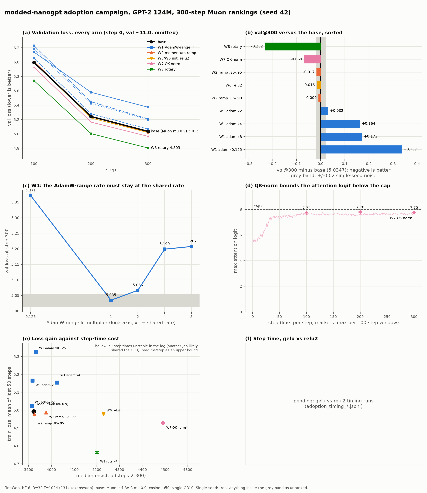
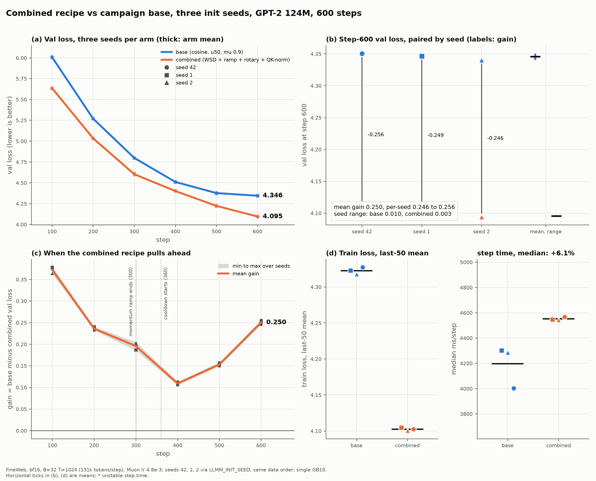

# modded-nanogpt adoption campaign: results (2026-10-30)

The user asked which of the modded-nanogpt speedrun intuitions are worth
adopting into this trainer's Muon track. This is the campaign report: how it
ran, what merged, what each arm scored, and what we would do next. The plan is
[`modded_nanogpt_adoption_plan_2026-10-30.md`](modded_nanogpt_adoption_plan_2026-10-30.md);
the Muon baseline it builds on is
[`muon_vs_adamw_124m_2026-10-29.md`](muon_vs_adamw_124m_2026-10-29.md) and
[`muon_hparam_sweep_124m_2026-10-30.md`](muon_hparam_sweep_124m_2026-10-30.md).

**Status: complete for the planned ranking queue.** Every arm below finished;
the table and figure render from the committed logs (`make figure-adoption`).
Every number here is single-seed, 300 steps unless a 600-step control says so.

## How the campaign ran

- **Plan.** Nine work items (W1 AdamW-range learning-rate multiplier, W2 Muon
  momentum warmup, W3 WSD cooldown and linear decay, W4 skipped as already
  adopted, W5 zero-init residual projections, W6 ReLU^2, W7 QK-norm with a
  fixed attention scale, W8 rotary embeddings, W9 untied LM head), each
  opt-in behind a flag or `-D` build constant so the default path stays
  bit-identical.
- **Worktree per item.** One `git worktree` and branch `mn/<item>` per item,
  so parallel agents never share a tree. Sonnet implemented, an independent
  Opus verifier re-ran the gates and attacked the tests with mutants, and the
  coordinator merged only on a merge-ready verdict, then re-ran the
  post-merge gates on `main`.
- **Ranking protocol.** Seed 42, 300 steps at 131k tokens/step, bf16 on the
  single GB10, score is val loss at step 300 against the base recipe
  (Muon lr 4.8e-3, mu 0.9, cosine, `-u 50`). Single-seed differences under
  about 0.02 nats are noise (the shaded band in the figure); anything headed
  for a default needs the three init seeds.
- **GPU queue.** One GPU, shared with a long-running seeds job, so ranking
  runs went through a file queue (one job at a time, only when no trainer was
  resident). Jobs that need a different build compile into a distinct binary
  name first, so a verifier's binaries are never clobbered.

## What merged, and what the verifiers proved

| item | merge | what the independent verifier established |
|---|---|---|
| W1 `-l_adam` | 7b36b40 | multiplier reaches the AdamW ranges only; `0` freezes them (refused under AdamW); mutant-checked unit test |
| W3 WSD | af6cad6 | zero-warmup, cooldown fraction and linear shape behave; two scheduler defects filed, not blocking (see follow-ups) |
| W2 `-mu_start/-mu_warmup` | 1353df8 | `muon_momentum_at` ramps correctly and resume reproduces the ramp; the per-step momentum reaches both Muon update paths (gate added) |
| W8 rotary | aeabaf4 | whole `test-mojo` passes under the flag; AdamW and Muon runs are byte-identical to the pre-campaign commit on CPU; three mutants caught ([rotary doc](rotary_embeddings_w8_2026-10-30.md)) |
| W5/W6 zero-init, ReLU^2 | 78c0806 | new `make verify-init` gate; flag-off fixtures byte-identical; a CPU relu2 gradient failure root-caused and fixed (below) ([W5/W6 doc](w5_w6_zero_init_proj_and_relu2_2026-10-30.md)) |
| W7 QK-norm | 841ea95 | gradients 16/16 on GPU and CPU with the flag on; backward mutants caught by `verify-gpu` and pytest, one scale-only mutant needed a dedicated gate ([W7 doc](qk_norm_attn_scale_2026-10-30.md)) |
| W9 untied head | f882464 | design and S0/S1 slices verified; a bf16 + sharded-Muon + `-untie_at` master-shard bug found statically and fixed before merge; W=1 path merge-ready ([design](untied_lm_head_design_2026-10-30.md)) |

## Results

Raw logs are committed as `docs/ai/data/adoption_*.jsonl`; this table is
written by `scripts/figure_adoption.py` between the markers.

<!-- adoption-table:start -->
| arm | flags | val@100 | val@200 | val@300 | vs base | train last-50 | ms/step | note |
|---|---|---:|---:|---:|---:|---:|---:|---|
| base (Muon mu 0.9) | `-opt muon -l 4.8e-3 -mu 0.9 -c 0.1 -gc 1.0 -u 50` | 5.9958 | 5.2421 | 5.0347 |  | 4.9929 | 3922 | reference; sweep-doc mu0.9 row was 5.0343 |
| W1 adam x0.125 | `-l_adam 0.125` | 6.1393 | 5.5792 | 5.3713 | +0.3366 | 5.3260 | 3932 | AdamW ranges at 6e-4: the sweep win was partly the AdamW-range rate |
| W1 adam x2 | `-l_adam 2` | 6.0539 | 5.2807 | 5.0665 | +0.0318 | 5.0239 | 3913 |  |
| W1 adam x4 | `-l_adam 4` | 6.1860 | 5.4254 | 5.1987 | +0.1641 | 5.1540 | 4026 |  |
| W1 adam x8 | `-l_adam 8` | 6.2294 | 5.4482 | 5.2074 | +0.1727 | 5.1651 | 3917 |  |
| W2 ramp .85-.90 | `-mu_start 0.85 -mu 0.9 -mu_warmup 300` | 6.0079 | 5.2399 | 5.0259 | -0.0087 | 4.9868 | 3977 |  |
| W2 ramp .85-.95 | `-mu_start 0.85 -mu 0.95 -mu_warmup 300` | 6.0063 | 5.2398 | 5.0174 | -0.0172 | 4.9770 | 3925 | flat 0.95 was 5.0732 in the sweep |
| W3 wsd u0 c.40 | `-k wsd -u 0 -cooldown 0.4 -decay_shape linear` | 5.9740 | 5.2500 | 4.7588 | -0.2759 | 4.8022 | 4036 |  |
| W3 wsd u0 c.45 | `-k wsd -u 0 -cooldown 0.45 -decay_shape linear` | 5.9711 | 5.2399 | 4.7675 | -0.2671 | 4.8096 | 4025 |  |
| W3 wsd u50 c.40 | `-k wsd -u 50 -cooldown 0.4 -decay_shape linear` | 6.0171 | 5.2655 | 4.8017 | -0.2330 | 4.8475 | 4005 |  |
| W9 untie at 2/3 | `-D LLMM_UNTIED_HEAD=1 -untie_at 0.667` | 5.9931 | 5.2314 | 5.0351 | +0.0004 | 4.9961 | 3966 | equal to the tied base at 300 steps |
| W6 relu2 | `-D LLMM_MLP_ACT=relu2` | 6.0008 | 5.2207 | 5.0184 | -0.0162 | 4.9780 | 4229 | at the noise edge alone |
| W5 zero-init proj | `-D LLMM_ZERO_INIT_PROJ=1` | 6.0260 | 5.2580 | 5.0436 | +0.0090 | 5.0007 | 3994 |  |
| W5+W6 both | `-D LLMM_ZERO_INIT_PROJ=1 -D LLMM_MLP_ACT=relu2` | 5.9983 | 5.2228 | 5.0088 | -0.0259 | 4.9693 | 4141 |  |
| W5 small-init proj | `-D LLMM_ZERO_INIT_PROJ=2` | 5.9996 | 5.2329 | 5.0274 | -0.0072 | 4.9850 | 4007 |  |
| W7 QK-norm | `-D LLMM_QK_NORM=1` | 5.9282 | 5.1637 | 4.9657 | -0.0689 | 4.9276 | 4492* | default attention scale |
| W7 QK-norm s0.12 | `-D LLMM_QK_NORM=1 -attn_scale 0.12` | 5.9321 | 5.1749 | 4.9790 | -0.0557 | 4.9402 | 4190 |  |
| W8 rotary | `-D LLMM_ROTARY=1` | 5.7416 | 5.0032 | 4.8031 | -0.2316 | 4.7635 | 4201* | largest single gain |
| W9 untied head | `-D LLMM_UNTIED_HEAD=1 -untie_at 0` | 6.1237 | 5.3820 | 5.1503 | +0.1156 | 5.1041 | 4014 | tied arm is the base |
| W9 untied, head x0.125 | `-D LLMM_UNTIED_HEAD=1 -untie_at 0 -l_head 0.125` | 6.4503 | 5.7214 | 5.5097 | +0.4751 | 5.4606 | 4026 |  |

`*` ms/step unstable in the log (spikes above 1.15x the median, or a step above 1.5x): another job probably shared the GPU, so read it as an upper bound.
<!-- adoption-table:end -->

ms/step is the median over steps 2-300. Rows with `*` and the hollow markers in
panel (e) have unstable step times in their own log (and `w7_qknorm`/`w8_rotary`
are known from the plan doc to have shared the GPU with a verifier compile), so
their ms/step is an upper bound; compare step-time cost with the timing runs
below, not with this column.



Panels: (a) val loss per arm; (b) val@300 minus base, sorted, shaded band is the
single-seed noise; (c) the W1 multiplier ladder on a log2 axis; (d) QK-norm max
attention logit against the 8.0 cap; (e) train loss against ms/step; (f) gelu
versus relu2 step time. A dark-mode copy is
`figures/modded_nanogpt_adoption_2026-10-30_dark.png`; the numbers behind both
are in the `.json` sidecar.

### gelu versus relu2 step time

An idle-box timing job (30 steps, two repeats per activation, 10 minutes of
idle before it starts, built to separate binaries) answers how much of the
step-time cost of relu2 is real.

<!-- adoption-timing:start -->
| run | median ms/step | min | max | steps |
|---|---:|---:|---:|---:|
| timing_gelu_r1 | 3914.1 | 3884.3 | 3935.9 | 30 |
| timing_gelu_r2 | 3931.9 | 3900.1 | 3945.4 | 30 |
| timing_relu2_r1 | 4048.6 | 4014.2 | 4057.3 | 30 |
| timing_relu2_r2 | 4044.7 | 4004.4 | 4054.5 | 30 |
| **mean of run medians** | gelu 3923, relu2 4047 | | | +3.2% |
<!-- adoption-timing:end -->

### W3 at 600 steps

Same seed and tokens, run separately from the 300-step ranking (the cosine control
and the best W3 recipe at `-x 600`); it is not mixed into the 300-step panels.

<!-- adoption-long:start -->
| run | val@100 | val@200 | val@300 | val@400 | val@500 | val@600 | ms/step |
|---|---:|---:|---:|---:|---:|---:|---:|
| w3_600_cosine_u50 | 6.0157 | 5.2574 | 4.7870 | 4.5110 | 4.3781 | 4.3470 | 3976 |
| w3_600_wsd_u0_c040_lin | 5.9704 | 5.2706 | 4.8307 | 4.5973 | 4.3912 | 4.2541 | 3968 |
| **wsd minus cosine at 600** | | | | | | -0.0929 | |
<!-- adoption-long:end -->

## Findings

Ordered by size of effect; every effect is single-seed (noise about 0.02).

1. **W3 is the largest gain: zero-warmup WSD with a linear cooldown to a 0.1
   floor** (`-k wsd -u 0 -cooldown 0.4 -decay_shape linear -q 0.1`). It beats
   cosine by 0.276 at 300 steps and by 0.093 at 600 steps, so the gain
   persists at twice the horizon but shrinks, since at 300 steps cosine's own
   tail is compressed. The cooldown fraction is insensitive between 0.40 and
   0.45, and a 50-step warmup costs 0.043 under Muon, so zero warmup is the
   recipe. The cooldown run trails mid-training because it sits at the full
   rate, then overtakes in the last steps (panel g).
2. **Rotary embeddings are second, 0.232 at 300 steps**, about ten times the
   noise band. The step-time cost in the table is an upper bound because that
   run shared the GPU with a verifier compile.
3. **QK-norm gives 0.069** and bounds the max attention logit near 7.7, just
   under the 8.0 that unit-RMS rows give at head dim 64 (panel d). The
   speedrun's 0.12 attention scale is a no-op at head dim 64 (it is 0.96x of
   1/sqrt(hd)), so keep the default scale.
4. **Zero-init and relu2 only help together: 0.026**, just outside the noise
   band. Each alone is within noise (zero-init projections, small-init
   projections, and relu2 alone). relu2 costs 3.2% step time on an idle GPU
   (the table above), with no cuBLASLt epilogue to hide the extra pass.
5. **The momentum ramp is worth 0.017**, inside the noise band but
   directionally right: a flat 0.95 lost in the earlier sweep, while ramping
   0.85 to 0.95 matches or edges the 0.9 base (low momentum early, high late).
6. **The AdamW-range learning rate must stay at the shared rate.** The W1
   ladder's optimum is the multiplier 1 (panel c); the earlier Muon sweep win
   was partly the AdamW ranges running at a high rate. The `-l_adam` flag
   stays for W9's `-l_head`, not as a recipe knob.
7. **W9 (untied head) does not pay at 300 steps.** Untying from scratch is
   0.116 worse (a zero head gives the body no gradient at step 0), a low head
   rate on top is 0.475 worse in total, and untying at two thirds of training
   is neutral. Its value, if any, awaits the plan's 2000-step comparison.

## Recommended recipe going forward

Base Muon recipe plus, as candidate flags:

```
-k wsd -u 0 -cooldown 0.4 -decay_shape linear -q 0.1
-D LLMM_ROTARY=1
-D LLMM_QK_NORM=1
-mu_start 0.85 -mu 0.95 -mu_warmup 300
```

Leave relu2/zero-init, the AdamW-range multiplier and the untied head at
their defaults for now. **Caveats: these are single-seed, 300-step rankings,
each measured one at a time; the combination has not been run, and effects
are not guaranteed to add (QK-norm and rotary both act on attention). Nothing
becomes a default until a combined run has three init seeds
(`-D LLMM_INIT_SEED=42|1|2`) and a longer horizon**, since the 2000-step Muon
run already showed 300-step orderings narrow with length. The next steps are
the three-seed combined run and the tokens-to-3.28 headline run the plan
calls for.

## Three-seed confirmation of the combined recipe

Six 600-step runs on the same setup as the Muon three-seed table in the README
(GPT-2 124M, bf16, FineWeb, 131k tokens/step, init seeds 42, 1, 2 via
`LLMM_INIT_SEED`, same data order). Arm `base` is the campaign base
(`-opt muon -l 4.8e-3 -mu 0.9 -c 0.1 -gc 1.0 -u 50`, cosine to 0). Arm
`combined` is the recommended recipe above, built with
`-D LLMM_ROTARY=1 -D LLMM_QK_NORM=1` and run with
`-k wsd -u 0 -cooldown 0.4 -decay_shape linear -q 0.1 -mu_start 0.85 -mu 0.95 -mu_warmup 300`
(schedule, momentum ramp, rotary, QK-norm; not relu2 or zero-init). Note the
README's Muon table uses `-c 0 -gc 0`, so its 4.36 mean is not this base
(`-c 0.1 -gc 1.0`); compare within this table. Logs:
`docs/ai/data/adoption_seed_<arm>_s<seed>_600.jsonl`.

<!-- adoption-seeds:start -->
pending
<!-- adoption-seeds:end -->

<picture>
  <source media="(prefers-color-scheme: dark)" srcset="../../figures/modded_nanogpt_adoption_seeds_2026-10-31_dark.png">
  
</picture>

Findings: pending the six runs.

## Incidents and lessons

- **Broken keep-both merge.** Resolving the W2 merge by keeping both sides of
  seven additive conflicts in `train_gpt2.mojo` compiled in review but left
  two hunks wrong; only `make build` after the merge caught it (fixed in
  c680f17). Lesson: a merge is not done until the build and gates run on the
  merged tree, and a conflict resolution gets its own verification.
- **GPU atomics make fp32 GPU runs non-reproducible.** Layer-0 LN1
  backward's `dgamma/dbeta` use `Atomic fetch_add`, so even the same commit
  against itself differs on GPU. A "flag-off byte-identity drift" that looked
  like a regression was a comparison artifact; identity checks must run on
  CPU (`LLMM_USE_CPU=1`), where `fe3312a` and the merged `main` are
  byte-identical for AdamW and Muon.
- **The queue runner's pgrep self-match.** The runner counted GPU-lock waiters
  with an unanchored `pgrep -f`, which matched a stale seven-hour-old
  `bash -c` poll loop whose command text contained the pattern; every ranking
  job deferred to its 90-minute cap and the GPU idled. Anchor the pattern or
  match on `comm`.
- **`git stash` is shared across worktrees.** The stash list belongs to the
  repository, not the worktree, and an agent popped another agent's stash.
  The protocol now forbids stash; set work aside as a WIP commit or a patch.
- **CPU attention soft-exp under relu2.** The relu2 CPU path failed 13/16
  gradient tensors on GELU-pretrained weights while the GPU passed. The first
  hypothesis (a wrong relu2 backward) was wrong; per-layer error grew with
  depth, and a float64 numpy forward showed the CPU error already present at
  layer 0 under gelu too. Root cause: CPU attention used the degree-4
  polynomial `software_emulated_exp` (max relative error 7.8e-4) while the GPU
  uses libm `exp`; under relu2 the badly conditioned residual stream amplifies
  that into a 20% gradient error in the lowest layers. relu2 builds now pass
  `use_soft_exp=False` (fc63c14), restoring 16/16 on CPU and GPU, and the
  relu2 trajectory reference is torch float64.

## Open follow-ups

- `-k linear` scheduler bug (`llmm/scheduler.mojo`): the learning rate rises
  instead of decaying. Pre-existing, found by the W3 verifier.
- WSD decay-point 1e-6 nudge rounds up for runs of 200601 steps or more; carry
  the cooldown as Float64.
- QK-norm: the eps choice, and the divergence at attention scale 0.5 (logit
  range above about 8) that the dedicated gate leaves unexplained.
- Deterministic GPU layer-0 LN `dparams` (ordered finalize like
  `layernorm_fused_residual_bwd`), so fp32 GPU identity checks become
  possible.
- Default CPU/Metal soft-exp decision: relu2 forced exact exp; whether the
  default path should too is open.
- cuBLASLt epilogue: no relu2 epilogue exists. If the timing table shows a
  real cost, the full-fusion route is a MAX-matmul epilogue lambda.
- W9 untied head: run the plan's 2000-step tied vs `-untie_at 0.667`
  comparison; 300 steps cannot show its value.

## Reproducing

```
make figure-adoption-collect   # copy finished logs from the item worktrees into docs/ai/data
make figure-adoption           # PNG (light + dark), JSON sidecar, and the tables above
make figure-adoption-seeds-collect figure-adoption-seeds   # the three-seed section's logs, table, figure
```

Collection reads the worktree `sweeps/` directories; rendering reads only
`docs/ai/data/adoption_*.jsonl` and `scripts/train_log.py`, no GPU.

## Headline run design: tokens to val 3.28 (designed, not yet run)

Plan section 5 calls for one full-batch run of the recommended recipe, scored
by the tokens it takes to reach val 3.28. This section fixes that design
before launch so the number cannot be tuned after the fact. The job script is
`$S/jobs/headline/run.sh` (session scratchpad), and its report is
`$S/jobs/headline/report.py`. The log will be committed as
`docs/ai/data/adoption_headline_tokens_to_328.jsonl`.

### The baseline: what the AdamW 524k run actually reached

The in-house AdamW run ([`gpt2_124m_fineweb_training_run.md`](gpt2_124m_fineweb_training_run.md))
used:

- `-b 32 -t 1024 -d 524288` (16 grad-accumulation steps)
- cosine schedule, `-l 6e-4 -u 700 -q 0.0 -c 0.1`
- `-v 250 -m 20`
- 19,552 steps, which is one epoch of 10,251,184,259 train tokens

Its val curve was read from `.autosentry/logs/process.log` by pairing each
`val loss` line with the step line before it. **It never reached val <= 3.28.**

| AdamW 524k baseline (`-m 20`) | step | tokens | val |
|---|---:|---:|---:|
| first val <= 3.29 | 17250 | 9.04B | 3.28825 |
| first val <= 3.285 | 18000 | 9.44B | 3.28461 |
| lowest val (after the step-19000 resume) | 19250 | 10.09B | 3.28068 |
| final | 19552 | 10.25B | 3.28070 |

"The AdamW run reached 3.28" (plan section 5, the Muon doc) is therefore a
two-decimal rounding of a curve that flattens at 3.2807.

The resumes are visible in the curve:

- Step 19500 read 3.28173 before incident 3 and 3.28075 after the resume from
  step 19000.
- The bf16 resume rebuilds the fp32 master copy from the bf16 params. The
  documented resume gap is about 3e-5 in train loss, and these val readings
  move by about 1e-3 across a resume.

### What the other figures measure

- **modded-nanogpt.** Its target is val <= 3.28 on the first 10,485,760 tokens
  of `fineweb_val_000000.bin` from the `kjj0/fineweb10B-gpt2` cached shards.
  Those shards are llm.c's `fineweb.py` output: FineWeb `sample-10BT`, GPT-2
  BPE, with the first 100M-token shard as val. The README reports wall time,
  so tokens follow from steps times batch. The plan quotes "under 0.7B tokens
  with Muon plus the record 5 architecture" and under 330M tokens today.
- **llm.c.** "10B tokens" is the length of Karpathy's 124M reproduction
  (one epoch of the same 10B sample); its final val is about 3.28.
- **Our data.** `data/.fineweb10B` holds 103 train shards and
  `fineweb_val_000000.bin` (200,001,024 bytes, 100M tokens). They come from our
  port of the same script, but byte identity with kjj0's val shard has not been
  checked.
- **Val set for this run.** The val loader reads sequentially from the start
  of the val shard. **`-m 320` at B=32, T=1024 is exactly 10,485,760 tokens**,
  the same val set as modded-nanogpt's. The baseline's `-m 20` (655,360 tokens)
  is a prefix of it. Whether that prefix is biased has not been measured.
  `$S/jobs/headline/baseline_eval.sh` (about 5 GPU-minutes, optional) scores
  `log124M/model_19552.bin` at both `-m 20` and `-m 320` so that the baseline
  can be quoted on the headline's val set.

### Recipe

The command is the base Muon recipe plus the campaign's recommended flags:

```
build:  make build-bf16 TRAIN_BIN_BF16=build/train_gpt2_bf16_headline MOJO_DEFINES="-D LLMM_ROTARY=1 -D LLMM_QK_NORM=1"
run:    BIN=build/train_gpt2_bf16_headline LLMM_LOG_LEVEL=verbose LLMM_LOG_FILE=docs/ai/data/adoption_headline_tokens_to_328.jsonl \
        make train-bf16 TRAIN_BIN_BF16=build/train_gpt2_bf16_headline MOJO_DEFINES="-D LLMM_ROTARY=1 -D LLMM_QK_NORM=1" ARGS="\
        -e d12 -i 'data/.fineweb10B/fineweb_train_*.bin' -j 'data/.fineweb10B/fineweb_val_*.bin' \
        -b 32 -t 1024 -d 524288 -x 3800 -v 100 -m 320 -s 0 -qk_clip 0 \
        -opt muon -l 4.8e-3 -c 0.1 -gc 1.0 -k wsd -u 0 -cooldown 0.4 -decay_shape linear -q 0.1 \
        -mu_start 0.85 -mu 0.95 -mu_warmup 300 -o checkpoints/headline_328 -n 500 -y 1"
```

- **`BIN=` is required.** `scripts/run_train_gpt2_bf16.sh` runs `$BIN` and
  ignores `TRAIN_BIN_BF16`. The first three-seed driver left `BIN=` out, so
  every one of its arms would have run the default `build/train_gpt2_bf16`;
  this was caught while that driver was running.
- **Learning rate.** It stays at 4.8e-3, which was tuned at 131k tokens per
  step. Muon's update is orthogonalized, so its size does not scale with
  gradient noise; a 4x batch is not an obvious reason to change the rate.
  This is untested at 524k and is listed as a risk.
- **Batch.** 524,288 tokens per step, as the AdamW run used and as
  modded-nanogpt's January 2025 records used (8x64x1024). The 300-step
  momentum ramp is therefore the speedrun's ramp in tokens as well as in
  steps.
- **Excluded: ReLU², zero-init projections, untied head and `-attn_scale`.**
  - ReLU² plus zero-init was worth 0.026 at 300 steps, one seed, just outside
    noise. ReLU² costs 3.2% per step on an idle GPU, and it has a CPU and
    fixture path that is not combined with rotary or QK-norm
    (`test_gpt2.mojo` refuses rotary+relu2 by `comptime assert`), so the
    headline binary would run without a verify gate for that combination.
  - The untied head is neutral at 300 steps.
  - `-attn_scale 0.12` does nothing at head_dim 64.

### Horizon and cooldown: `-x 3800`

- **Token budget.** 3800 x 524,288 = 1,992,294,400 tokens (1.99B). That is
  about 2.8x the 0.7B modded-nanogpt needed with a fuller architecture, and
  about 1/5 of the AdamW run.
- **Schedule.** The WSD decay starts at floor(3800 x 0.6) = **step 2280
  (1.195B tokens)**. The rate then falls linearly to 0.1x by step 3800. The
  momentum ramp ends at step 300 (157M tokens).
- **The cooldown moves the crossing.** At 600 steps the cooldown arm trailed
  cosine until the last 240 steps and then finished 0.093 lower. So the
  tokens-to-3.28 figure belongs to the (recipe, `-x`) pair, not to the
  recipe alone.
- **The stable phase does not depend on `-x`.** The learning rate is
  constant, there is no warmup and the momentum ramp is fixed, so the
  trajectory up to step 2280 is identical for any horizon that long or
  longer. A crossing at or before step 2280 would therefore hold for every
  `-x >= 3800`.
- **Reporting rule.**
  1. The headline is the first eval with val <= 3.28 exactly (no rounding).
  2. Report it in tokens (step x 524,288), with the bracket from the
     previous eval.
  3. Say whether it fell in the stable phase (step <= 2280) or in the
     cooldown.
  4. A cooldown crossing is quoted as "at `-x 3800`". It is an upper bound on
     what this recipe can do, because a shorter horizon would start its
     cooldown earlier.
  5. Also give the first evals at or below 3.285 and 3.29, next to the
     baseline's 9.44B and 9.04B, and the minimum val.
- **If 3.28 is not reached by 1.99B.** Report "not reached at 1.99B" with
  the final val and the gap. The next run would be `-x 5700` (2.99B), not a
  continuation, because a continued run would re-enter the cooldown from a
  run that has already decayed.
- **Val cadence.** Every 100 steps (52.4M tokens) at `-m 320`, 39 evals in
  all. This brackets the crossing to 52M tokens. 50-step evals would double
  the val cost for a resolution that is finer than the val-set noise.
- **Checkpoints.** Every 500 steps plus the final one, 8 files, so a crash
  costs at most 500 steps (about 2.2 h). Each pair is at most about 1.25 GB:
  model 249 MB plus a state that is no larger than AdamW's 996 MB m+v. That
  is about 10 GB in total against 2.2 TB free.

### Wall clock (estimate)

| part | arithmetic | time |
|---|---|---:|
| train | 3800 steps x 4 x 3.92 s (base at 131k, idle) = 59,600 s | 16.6 h |
| rotary + QK-norm | +3 to 7% (the W7 0.12 arm ran at 4186 vs 3922 ms; the W8 figure is an upper bound) | +0.5 to 1.2 h |
| val | 39 evals x 320 forwards x about 0.33 s (a forward is about 1/3 of the 0.98 s fwd+bwd micro-step) | about 1.1 h |
| smoke, build, checkpoints | | under 0.2 h |
| **total** | | **about 18 to 19 h** |

- The AdamW run measured 15.6 s per step at 524k, which agrees with 4 x 3.92 s.
- Muon's optimizer cost is about 0.25% at this batch.
- The combined arms of the three-seed run will replace the rotary and
  QK-norm row with a measured figure: the wall clock is 3800 x 4 x their
  median ms/step.
- The val time is an estimate. It was not measured.

### Memory

- The resident seed-42 base run (B=32, Muon, bf16) uses 43,457 MiB in
  `nvidia-smi`.
- Gradient accumulation does not change the per-micro-batch footprint, so
  524k tokens per step at B=32 has the same footprint as 131k.
- Rotary adds a 256 KB cos/sin table and rotates the qkv activation in place.
- QK-norm normalizes the head buffers in place, and its backward recomputes
  the statistics from `acts.qkv`, so it adds no activation buffers.
- Val reuses the same B=32 forward.
- Expected total: about 44 GB of the 120 GB unified memory. Check
  `nvidia-smi` for other tenants before launch, because an 87 GB vLLM tenant
  slows tensor-core kernels about 1.3x.

### Risks, and what run.sh does about them

- **The combination has not run at this scale.** The three-seed 600-step
  run (base vs combined, 131k) is the go/no-go. Go means:
  1. The combined arm beats base at val@600 in all three seeds.
  2. No non-finite loss.
  3. `qk_max` is present in the combined logs (proof that the right binary
     ran) and stays at or below 8.0.
- **The learning rate was tuned at 131k.** If the run diverges, the 0.1 floor
  will not rescue it. Watch train loss over the first 300 steps.
- **QK-norm logits over a long run.** At the default scale the logit is
  bounded by head_dim x scale = 8; the logged `qk_max` shows how close it
  gets. The unexplained divergence at `attn_scale` 0.5 (logit range 32) does
  not apply at the default scale.
- **bf16 resume is not bit-exact** (the fp32 master is rebuilt). Resumes are
  counted in the report and logged in `decisions.txt`.
- **Log size.** Verbose logging is about 200 bytes per step, about 1 MB for
  the whole run. Verbose is required for `qk_max` and the per-step `ms` the
  figure script uses.
- **Other jobs.** The run takes the shared GPU lock and refuses to start
  while any other trainer process is on the GPU.

run.sh behaviour, in order:

1. Exit 0 at once if `run.exit` is 0.
2. Preflight: refuse if another trainer is running, if there are not 103
   train shards plus the val shard, if less than 30 GB of disk is free, if
   the trainer sources are dirty, or if HEAD differs from the first launch.
3. Build through `build_slot` and check the binary's mtime against the
   newest source.
4. Before the first real step, run a 5-step smoke on the exact binary and
   flags. It asserts finite losses, `qk_max` present, and batch 524288 with
   grad_accum 16.
5. Before every launch, move an incomplete newest checkpoint pair aside (the
   trainer resumes from the highest `model_N.bin` even if its state file is
   missing).
6. Run with `-y 1`, resuming automatically up to 3 times after a crash.
7. Require a val event at step 3800, write `report.txt` and `run.exit`.

The log is appended across resumes. `report.py` keeps the last occurrence of
each step and reads the log through `scripts/train_log.py`:

```
python3 $S/jobs/headline/report.py   # defaults to docs/ai/data/adoption_headline_tokens_to_328.jsonl
```

It prints:

- every eval as step, tokens and val
- `first_val_le_3.28`, `first_val_le_3.285` and `first_val_le_3.29`, each with
  its bracket and the AdamW figure next to it
- the minimum val
- median ms per step and training hours
- the largest `qk_max`

## AI use statement

Written with AI assistance (Claude Code, Sonnet 5.5 results agent; item
implementations by Sonnet agents and independent verification by Opus agents),
directed by Evan Owen. The headline-run design section was written by a Claude Code Opus 5.5 design agent, also directed by Evan Owen.
