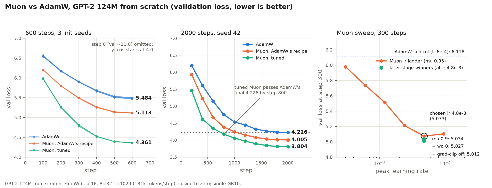

# Muon vs AdamW, GPT-2 124M from random init (600 steps, FineWeb)

First controlled AdamW-vs-Muon comparison in `llm.mojo`, run on the `muon-int` branch
(commit `f646bbe`). It is an early-training comparison only: 600 steps at 131,072
tokens/step = 78.6M tokens, one seed per optimizer. The Muon implementation itself was
verified against torch on other tracks; this document reports only the convergence run.
Format follows [`gpt2_124m_fineweb_training_run.md`](gpt2_124m_fineweb_training_run.md).
Two follow-ups were added later: a three-seed repeat with a tuned-Muon arm ("Seed spread") and
a 2000-step run at seed 42 ("2000-step run"); the sections up to "Caveats" describe the original
single-seed pair.

**Validation gate:** the runs' own val-loss curves. Both runs share the same init (step-0
val loss is identical, 11.009493, and step-1 train loss is identical, 11.013952), data order
and LR schedule, so the optimizer is the only intended difference.

## Setup

- **Model:** GPT-2 124M (`-e d12`), random init, bf16 (fp32 master weights/moments).
- **Data:** FineWeb-10B shards (`data/.fineweb10B/fineweb_train_*.bin`, `fineweb_val_*.bin`).
- **Batch:** `-b 32 -t 1024 -d 131072` (4 grad-accum micro-steps), 600 steps.
- **Recipe (both):** peak lr `6e-4`, 50 warmup steps, cosine to 0 (`-q 0.0`, schedule spans the 600 steps), weight decay 0.1, grad-norm clip 1.0, QK-clip off (`-qk_clip 0`), val every 100 steps over 20 batches, no sampling, no checkpoints.
- **Muon:** `-opt muon -mu 0.95`, same peak lr and weight decay as AdamW (no per-optimizer lr tuning was done).
- **Binary:** `build/train_gpt2_bf16` built by `make build-bf16` at 2026-10-29 20:58:28 -0400 from commit `f646bbe` (sources last modified 20:56:30, i.e. the binary is newer than all sources). Mojo toolchain as provisioned in the worktree pixi env.
- **Hardware:** single GB10 (DGX Spark class), Linux 6.17.0-1026-nvidia. A ~37 GB vLLM process (another user's, pid 862977, `VLLM::EngineCore`, 37426 MiB) was resident on the GPU before both runs (`nvidia-smi` captured before each run). It slows tensor-core kernels, so absolute step times are contended.

Commands (sequential, never concurrent; logs under the session scratchpad `jobs/`):

```
LLMM_LOG_LEVEL=verbose LLMM_LOG_FILE=conv_adamw.jsonl make train-bf16 ARGS="-e d12 -i 'data/.fineweb10B/fineweb_train_*.bin' -j 'data/.fineweb10B/fineweb_val_*.bin' -b 32 -t 1024 -d 131072 -l 6e-4 -u 50 -q 0.0 -c 0.1 -gc 1.0 -x 600 -v 100 -m 20 -s 0 -opt adamw -mu 0.95 -qk_clip 0"
LLMM_LOG_LEVEL=verbose LLMM_LOG_FILE=conv_muon.jsonl  make train-bf16 ARGS="... same ... -opt muon -mu 0.95 -qk_clip 0"
```

(The glob patterns must be single-quoted inside `ARGS`, otherwise the shell expands them and the trainer prints usage.) Each command was dry-run with `-x 3 -v 0` first. JSON-lines logs are committed in `docs/ai/data/muon_vs_adamw_{adamw,muon}.jsonl`; tables below come from `scripts/compare_runs.py` (built on `scripts/train_log.py`):

`pixi run python scripts/compare_runs.py docs/ai/data/muon_vs_adamw_adamw.jsonl docs/ai/data/muon_vs_adamw_muon.jsonl --names AdamW Muon`

## Results

Both runs exited 0, no NaN/divergence. Final val loss: **AdamW 5.4690, Muon 5.1115** (Muon 0.358 lower). Muon first reaches AdamW's final val loss at the step-400 eval (5.2565).



Summary figure for this doc (all three panels computed from the committed logs; regenerate with `make figure-muon`).

| step | val AdamW | val Muon | delta (Muon-AdamW) |
|---:|---:|---:|---:|
| 0 | 11.0095 | 11.0095 | +0.0000 |
| 100 | 6.5674 | 6.2045 | -0.3628 |
| 200 | 6.1798 | 5.7955 | -0.3843 |
| 300 | 5.9016 | 5.4905 | -0.4111 |
| 400 | 5.6607 | 5.2565 | -0.4041 |
| 500 | 5.5044 | 5.1361 | -0.3682 |
| 600 | 5.4690 | 5.1115 | -0.3575 |

| steps | train AdamW | train Muon | delta (Muon-AdamW) |
|---|---:|---:|---:|
| 1-50 | 8.1260 | 8.3476 | +0.2216 |
| 51-100 | 6.6972 | 6.3856 | -0.3116 |
| 101-150 | 6.4179 | 6.0381 | -0.3798 |
| 151-200 | 6.2066 | 5.8253 | -0.3813 |
| 201-250 | 6.0675 | 5.6694 | -0.3981 |
| 251-300 | 5.9161 | 5.5068 | -0.4092 |
| 301-350 | 5.7816 | 5.3700 | -0.4116 |
| 351-400 | 5.6727 | 5.2613 | -0.4114 |
| 401-450 | 5.5575 | 5.1626 | -0.3949 |
| 451-500 | 5.4737 | 5.0976 | -0.3761 |
| 501-550 | 5.4421 | 5.0758 | -0.3664 |
| 551-600 | 5.4133 | 5.0573 | -0.3560 |

| run | mean ms/step | tok/s | steps timed |
|---|---:|---:|---:|
| AdamW | 4171.4 | 31782 | 598 |
| Muon | 3972.0 | 32986 | 598 |

First Muon val <= AdamW final val (5.4690, step 600): step 400 (val 5.2565)

Timing: step 1 excluded plus step 2 (warmup). The AdamW mean is inflated by 40 steps above 5 s (max 13.0 s), all absent in the Muon run; this looks like interference from the co-resident GPU tenant, not the optimizer. Medians are the fairer comparison: **AdamW 4008 ms, Muon 3955 ms** (min 3920 vs 3889 ms). So at this batch size Muon was within noise of AdamW (or marginally faster). This is expected, not a contradiction of the +29% figure measured at the 4k-token smoke config: the Muon optimizer step is a fixed cost of roughly 20-40 ms per optimizer step (Newton-Schulz GEMMs plus elementwise passes; see the performance section of [`muon_muonclip_implementation_2026-10-29.md`](muon_muonclip_implementation_2026-10-29.md)), and here each optimizer step follows ~3.9 s of forward/backward over 4 accumulated micro-batches, so the overhead is about 1%. At the full run's 524k tokens/step it would be about 0.25%. The +29% applies only when a whole step is a single B=4 micro-batch.

## Caveats

- Single seed per optimizer in this original pair (the "Seed spread" section below repeats it at three init seeds). A 0.36 val-loss gap this large and consistent across all evals and 50-step train windows is unlikely to be seed noise, but it is not quantified.
- 600 steps / 79M tokens is early training with a cosine schedule compressed to that length. The gap peaked (-0.41 at step 300) and was narrowing (-0.36 at step 600); this says nothing about the converged gap (the AdamW 524k-token run reached val 3.28).
- Muon used AdamW's lr and weight decay without tuning; AdamW used the recipe from the earlier full run, scaled down. Neither was tuned for this short horizon.
- Muon's first 50 steps had higher train loss (+0.22) than AdamW, then crossed over.
- Step times were measured under GPU contention (vLLM tenant), with bursty slowdowns in the AdamW run.
- Muon kernel is unoptimized (a separate track covers that).

## Seed spread (3 seeds x 600 steps)

Same matched recipe as above (131k tokens/step, 600 steps, warmup 50, 6e-4 cosine, wd 0.1, clip 1.0), repeated at init seeds 42, 1 and 2 (build-time `-D LLMM_INIT_SEED=<n>`; seed 42 is the default build and its AdamW/Muon pair is the original run above). A third arm, **Muon tuned**, uses the recipe from the 300-step Muon sweep: `-opt muon -l 4.8e-3 -mu 0.9 -c 0 -gc 0` (everything else as the base args). Both optimizers of a seed ran on the same binary, sequentially on one GPU. Logs: `data/muon_vs_adamw_{adamw,muon}.jsonl` (seed 42 matched) and `data/muon_seeds_s<seed>_<arm>_600.jsonl` (the rest).

**Seed 42** (val loss)

| step | AdamW | Muon matched | Muon tuned |
|---:|---:|---:|---:|
| 100 | 6.5674 | 6.2045 | 5.9737 |
| 200 | 6.1798 | 5.7955 | 5.2618 |
| 300 | 5.9016 | 5.4905 | 4.8125 |
| 400 | 5.6607 | 5.2565 | 4.5248 |
| 500 | 5.5044 | 5.1361 | 4.3944 |
| 600 | 5.4690 | 5.1115 | 4.3642 |

**Seed 1** (val loss)

| step | AdamW | Muon matched | Muon tuned |
|---:|---:|---:|---:|
| 100 | 6.5423 | 6.2020 | 5.9738 |
| 200 | 6.1761 | 5.7958 | 5.2535 |
| 300 | 5.9074 | 5.4877 | 4.7785 |
| 400 | 5.6847 | 5.2525 | 4.5158 |
| 500 | 5.5355 | 5.1320 | 4.3873 |
| 600 | 5.4994 | 5.1074 | 4.3575 |

**Seed 2** (val loss)

| step | AdamW | Muon matched | Muon tuned |
|---:|---:|---:|---:|
| 100 | 6.5443 | 6.2066 | 5.9883 |
| 200 | 6.1671 | 5.7987 | 5.2644 |
| 300 | 5.8931 | 5.4989 | 4.8070 |
| 400 | 5.6720 | 5.2683 | 4.5206 |
| 500 | 5.5195 | 5.1450 | 4.3912 |
| 600 | 5.4839 | 5.1202 | 4.3605 |

**Step 600 across seeds** (val loss)

| arm | seed 42 | seed 1 | seed 2 | mean | min-max |
|---|---:|---:|---:|---:|---:|
| AdamW | 5.4690 | 5.4994 | 5.4839 | 5.4841 | 5.4690-5.4994 |
| Muon matched | 5.1115 | 5.1074 | 5.1202 | 5.1130 | 5.1074-5.1202 |
| Muon tuned | 4.3642 | 4.3575 | 4.3605 | 4.3607 | 4.3575-4.3642 |

**Train loss, mean of steps 551-600**

| arm | seed 42 | seed 1 | seed 2 | mean |
|---|---:|---:|---:|---:|
| AdamW | 5.4133 | 5.4451 | 5.4273 | 5.4286 |
| Muon matched | 5.0573 | 5.0529 | 5.0665 | 5.0589 |
| Muon tuned | 4.3389 | 4.3341 | 4.3364 | 4.3365 |

**First eval step at which Muon val <= that seed's AdamW final val (step 600)** (evals are every 100 steps)

| arm | seed 42 | seed 1 | seed 2 |
|---|---:|---:|---:|
| Muon matched | 400 | 300 | 400 |
| Muon tuned | 200 | 200 | 200 |


Reading: the init-seed spread at step 600 is small (AdamW 0.030, Muon matched 0.013, Muon tuned 0.007 val-loss range), far below the gaps between arms (matched Muon -0.37 and tuned Muon -1.12 vs AdamW on the mean), so the single-seed conclusion holds. Matched Muon reaches AdamW's final val 200-300 steps early (first at step 400, 300, 400 for seeds 42, 1, 2); tuned Muon does so by step 200 in every seed.

Caveats: only the init seed varied, the data order is fixed, so this does not capture data-order variance; n=3 is a spread estimate, not a confidence interval. The tuned recipe came from a 300-step single-seed sweep (seed 42), so seed 42 is partly in-sample for the tuned arm; seeds 1 and 2 are the out-of-sample check. The comparison is asymmetric in tuning effort: Muon tuned had its lr, momentum, weight decay and clip swept, while the AdamW control kept the recipe scaled down from the earlier full run and was not re-tuned for this horizon, so the tuned-vs-AdamW gap mixes optimizer and tuning effort (the matched arm is the like-for-like comparison). Single GPU; parts of the chain shared the GPU with sibling agents' tests, so timings are not reported here (only losses).

## 2000-step run (seed 42)

Same recipe family at 2000 steps (131k tokens/step, 262M tokens): `-x 2000 -u 150 -v 200`, cosine to zero, init seed 42, AdamW and Muon matched with the base args above, Muon tuned with `-opt muon -l 4.8e-3 -mu 0.9 -c 0 -gc 0`. Logs: `data/muon_seeds_s42_{adamw,muon,muon_tuned}_2000.jsonl`. Val loss every 200 steps:

| step | AdamW | Muon matched | Muon tuned | matched - AdamW | tuned - AdamW |
|---:|---:|---:|---:|---:|---:|
| 0 | 11.0095 | 11.0095 | 11.0095 | +0.0000 | +0.0000 |
| 200 | 6.1969 | 5.9316 | 5.4575 | -0.2653 | -0.7394 |
| 400 | 5.6119 | 5.2271 | 4.6201 | -0.3848 | -0.9918 |
| 600 | 5.1474 | 4.6685 | 4.3446 | -0.4790 | -0.8028 |
| 800 | 4.7509 | 4.3850 | 4.1772 | -0.3659 | -0.5736 |
| 1000 | 4.5351 | 4.2441 | 4.0586 | -0.2910 | -0.4765 |
| 1200 | 4.4443 | 4.1499 | 3.9710 | -0.2944 | -0.4733 |
| 1400 | 4.3243 | 4.0774 | 3.8930 | -0.2469 | -0.4313 |
| 1600 | 4.2640 | 4.0325 | 3.8402 | -0.2314 | -0.4237 |
| 1800 | 4.2322 | 4.0097 | 3.8105 | -0.2225 | -0.4217 |
| 2000 | 4.2259 | 4.0051 | 3.8045 | -0.2208 | -0.4215 |


Train loss, mean of steps 1951-2000: AdamW 4.1793, Muon matched 3.9639, Muon tuned 3.7686.

First eval at which a Muon arm is at or below AdamW's step-2000 val (4.2259): Muon matched at step 1200 (4.1499; step 1000 was 4.2441); Muon tuned at step 800 (4.1772; step 600 was 4.3446), so the tuned arm passes AdamW's final value between steps 600 and 800, i.e. within the first 30-40% of the steps (evals are every 200 steps, so the crossing is bracketed, not located exactly).

Step time (steps 3-2000, from the logs): mean / median ms per step were AdamW 3892 / 3893, Muon matched 4020 / 3949, Muon tuned 4054 / 4006, i.e. Muon was 1.4% (matched) and 2.9% (tuned) slower by median. Only part of that is the optimizer: the expected Newton-Schulz cost is roughly 20-40 ms per step (0.5-1%), and the two Muon arms run identical optimizer code yet differ by 1.4% from each other. Both Muon logs show contention that the AdamW log does not: AdamW has no step above 4.5 s, matched Muon has 59 (all from step 1566 on, where its median rises to about 4.10 s, max 10.8 s) and tuned Muon has 48 spread through the run (max 9.6 s). Over steps 3-1500, before the matched arm's slow stretch, matched Muon was 1.3% slower by median. Read the step-time gap as at most 1-3% and partly noise from sibling work on the GPU, not as a measured optimizer cost.

Reading: the matched-Muon lead is -0.265 at step 200, widens to -0.479 at step 600, then narrows to -0.221 at step 2000 as both optimizers anneal. The tuned arm leads by -0.422 at step 2000 (narrowing from -0.992 at step 400). The lead shrinks but does not close within this horizon.

Caveats: single seed for the 2000-step runs; the AdamW control was not re-tuned for this horizon either; same cosine-to-zero schedule with 150 warmup steps for all arms; the tuned recipe came from a 300-step single-seed sweep, not re-tuned for 2000 steps (a lower lr might do better at this horizon, so the narrowing of the tuned lead is not evidence about its best case); 262M tokens is early training, far from the 524k-token-batch converged run, so this says nothing about the converged gap.

## AI use statement

Written with AI assistance (Claude Code, Sonnet agent; numbers re-verified against the committed logs by an Opus review agent), directed by Evan Owen.
